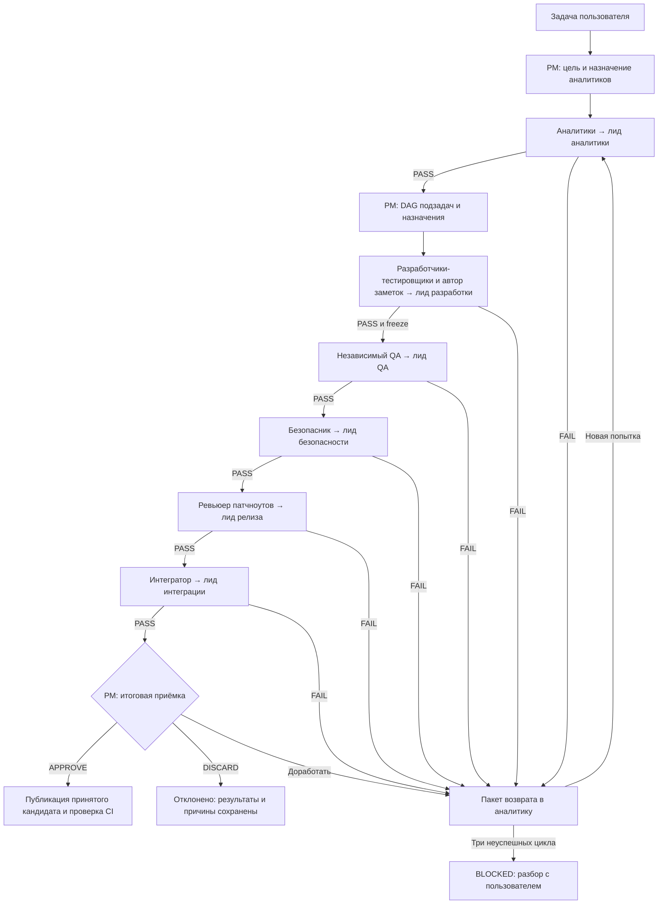

# Граф разработки с независимой приёмкой

Основной агент работает как project manager (PM): разбивает задачу, назначает
исполнителей и лидов, проверяет доказательства и принимает итоговый кандидат.
Реализация делегируется. Небольшую явно помеченную задачу PM может взять себе,
но результат принимает другой агент.

Это инструменты разработки QWS, не часть работающего сайта. Приложение остаётся
на версии 1.5.0; внутренние изменения процесса не создают уведомления пользователям.
Для графа есть отдельный GitHub Actions workflow, который работает независимо от
того, пропускает ли Release уже опубликованную версию.

## Исполнение и роли

`.codex/config.toml` включает шесть субагентов дополнительно к основному PM.
Профили в `.codex/agents/*.toml` задают инструкции и наследуют модель сессии.
Совместимые новые сессии Codex обнаруживают эти профили. В текущем ChatGPT Work
инструмент `collaboration.spawn_agent` принимает текст поручения, но не отдельный
параметр native role: PM читает нужный TOML и включает его инструкции в поручение.
Одна установка файлов не перенастраивает уже запущенную сессию.

`scripts/agent-flow.mjs` — локальный контроллер состояния и допустимых переходов.
Он не запускает LLM, не создаёт субагентов и не является фоновым сервисом. PM
действительно вызывает `spawn_agent`, передаёт конкретный контракт и использует
`send_message`/`interrupt_agent` при координации. После отмены назначения в БД PM
обязан отдельно прервать соответствующий живой контекст.

| Фаза | Исполнители | Независимый лид |
|---|---|---|
| ANALYSIS | `analyst` | `analysis_lead` |
| DEVELOPMENT | `developer_tester`, `patchnotes_author` | `development_lead` |
| QA | `qa` | `qa_lead` |
| SECURITY | `security` | `security_lead` |
| NOTES | `patchnotes_reviewer` | `release_lead` |
| INTEGRATION | `integrator` | `integration_lead` |
| PM_REVIEW | `project_manager` принимает весь результат | Все предыдущие PASS обязательны |

Автор патчноутов завершает необходимые правки во время DEVELOPMENT. NOTES —
проверка уже подготовленных материалов на неизменном кандидате. Для чисто
внутренних инструментов проверяется обоснованное отсутствие изменения версии и
пользовательских новостей. При изменении приложения сохраняются правила AGENTS.md:
SemVer, уникальная новость, русский текст и английский перевод, артефакты релиза.



## Запуск и формат контрактов

Нужен Node.js 22.13 или новее со встроенной SQLite. Команды запускаются из корня
Git-репозитория. Установка пакетов или ключи API для самого контроллера не нужны.
Реальные команды проверок могут требовать обычной настройки проекта.

```text
node scripts/agent-flow.mjs <command> <run-id> [input.json | -]
```

`run-id` и ID задач — до 64 символов: буквы/цифры, `.`, `_`, `-`; первый символ —
буква или цифра. Actor ID — непустой идентификатор реального контекста, например
`/root/analysis_01`. JSON можно передать из файла или через stdin (`-`). Каждый
ответ — JSON. Ошибочный вызов возвращает ненулевой exit code; после операции PM
также проверяет `phase`, `interrupted` и `lastReturn`: сохранённый возврат в анализ
может быть штатным JSON-результатом команды.

| Команда | JSON-вход и действие |
| --- | --- |
| `init` | Полный план: `goal`, `acceptance`, `pm`, `actors`, `tasks` |
| `register` | `{actor: PM, id: nativeAgentId, role}`; роль существующего ID не меняется |
| `status`, `ready` | Без входа; состояние и готовые задачи, проверка просроченных назначений |
| `claim` | `{actor, task, leaseSeconds?}`; создаёт assignment UUID |
| `heartbeat` | `{actor, task, assignment, leaseSeconds?}`; продлевает RUNNING-назначение |
| `check` | `{actor, task, assignment, name}`; запускает проверку, объявленную планом |
| `submit` | `{actor, task, assignment, summary, evidence: [paths]}` |
| `review` | `{actor: leadId, task, assignment, verdict: PASS/FAIL, evidence: [paths], reason?}` |
| `fail` | `{actor, reason, task?}`; сообщение о провале текущей работы |
| `replan` | `{actor: PM, reason, plan: fullPlan}`; новый план только в ANALYSIS |
| `decide` | `{actor: PM, verdict: APPROVE/DISCARD, reason}` |

Строковые значения в этой таблице — обозначения полей; реальный ввод ниже является
валидным JSON. `assignment` берётся из `tasks[].assignment.id` ответа `claim` и
обязательно передаётся для работы с этим назначением. Старый ID не используется
повторно после возврата или перепланирования.

План содержит хотя бы одну задачу для **каждой** фазы ANALYSIS, DEVELOPMENT, QA,
SECURITY, NOTES и INTEGRATION. PM_REVIEW — итоговое решение, а не отдельная задача.
`deps` может ссылаться на предыдущую или текущую фазу, но не на будущую. Циклы и
неизвестные зависимости запрещены. `paths` — буквальные относительные пути или
каталоги; `[` и `]` в Nuxt-маршрутах, например `pages/share/[id].vue`, означают
обычные символы. `*`, `?`, абсолютные пути, backslash, компоненты `.`, `..` и
`.git` запрещены. `.agent-workflows` и его содержимое защищены, но отдельное имя
вроде `.agent-workflows-tools` допустимо. Write scopes задаются только для DEVELOPMENT.
Для небольшого исключения PM задача DEVELOPMENT получает `small: true`; её роль
остаётся `developer_tester` или `patchnotes_author`, а принимает её другой лид.

Пример плана для внутреннего инструмента; PM адаптирует критерии и команды к
реальной задаче. Регистрация контекстов выполняется после их фактического запуска:

```sh
umask 077
mkdir -p .agent-workflows
cat > .agent-workflows/plan.json <<'JSON'
{
  "goal": "Изменить инструменты разработки, сохранив поведение приложения",
  "acceptance": ["Контроллер и профили проверены; версия приложения не меняется"],
  "pm": "/root",
  "actors": [],
  "tasks": [
    {"id":"analyse","phase":"ANALYSIS","role":"analyst","acceptance":["План, зависимости и критерии проверяемы"]},
    {"id":"runtime","phase":"DEVELOPMENT","role":"developer_tester","acceptance":["Реализация и регрессионные тесты готовы"],"paths":["scripts","tests"],"deps":["analyse"]},
    {"id":"instructions","phase":"DEVELOPMENT","role":"patchnotes_author","acceptance":["Профили и инструкции соответствуют реализации; app news не меняются"],"paths":[".codex","AGENT_WORKFLOW.md",".agents/skills/project-orchestration"],"deps":["analyse"]},
    {"id":"qa","phase":"QA","role":"qa","acceptance":["CLI-сценарии и ошибки воспроизведены"],"deps":["runtime","instructions"],"checks":[{"name":"graph-tests","argv":["node","--test","tests/agent-flow.test.mjs"],"timeoutSeconds":300}]},
    {"id":"security","phase":"SECURITY","role":"security","acceptance":["Границы состояния, путей, процессов и доказательств проверены"],"deps":["qa"]},
    {"id":"notes","phase":"NOTES","role":"patchnotes_reviewer","acceptance":["Документация и отсутствие пользовательских новостей обоснованы"],"deps":["security"]},
    {"id":"integrate","phase":"INTEGRATION","role":"integrator","acceptance":["Общий кандидат и результаты проверены"],"deps":["notes"],"checks":[{"name":"candidate-diff","argv":["git","diff","--cached","--check"],"timeoutSeconds":60}]}
  ]
}
JSON
node scripts/agent-flow.mjs init change-001 .agent-workflows/plan.json
node scripts/agent-flow.mjs ready change-001
```

Затем PM запускает аналитика настоящим `collaboration.spawn_agent`, получает его
ID и регистрирует контекст. Вместо показанного `/root/analysis_01` используется
возвращённый инструментом ID:

```sh
node scripts/agent-flow.mjs register change-001 - <<'JSON'
{"actor":"/root","id":"/root/analysis_01","role":"analyst"}
JSON
node scripts/agent-flow.mjs claim change-001 - <<'JSON'
{"actor":"/root/analysis_01","task":"analyse","leaseSeconds":900}
JSON
```

Исполнитель получает UUID назначения и критерии. Он сохраняет **реальный**
очищенный отчёт в `.agent-workflows/change-001/evidence/analysis-01.md`. После этого
`submit` содержит его actor/task/assignment, краткое резюме и путь к отчёту. PM
запускает другой контекст `analysis_lead`, регистрирует его, передаёт результаты
аналитика и получает отдельный отчёт лида. Лид вызывает `review` с тем же assignment,
своим ID, PASS/FAIL и своим файлом доказательств. Подделывать отчёты командами,
которые только пишут слово PASS, недопустимо.

После всех PASS фазы контроллер открывает следующую. PM снова читает `ready`,
запускает готовые роли, регистрирует их и выдаёт назначения. Не запускайте весь
список заранее: он превышает доступные одновременные контексты. Лид занимает
резервированный слот. В DEVELOPMENT готовятся все изменения; перед последним PASS
PM/исполнитель проверяет diff и выполняет `git add` только для относящихся к задаче
файлов. Не используйте автоматическое staging посторонних изменений.

В QA/INTEGRATION назначенный исполнитель сначала выполняет проверки по их имени.
Например, после регистрации QA-контекста и `claim` задачи `qa`, подставьте его
реальный ID и UUID из ответа в такой вызов:

```sh
node scripts/agent-flow.mjs check change-001 - <<'JSON'
{"actor":"/root/qa_01","task":"qa","assignment":"UUID-из-claim","name":"graph-tests"}
JSON
```

`check` не принимает произвольный argv из результата агента: массив
команды и timeout заранее определены планом. Таймаут проверки — 1–1800 секунд,
вывод ограничен 1 МиБ; сырые stdout/stderr не записываются в ledger, сохраняются
только размер, SHA-256, длительность и exit code. Для чтения результатов необходим
отдельный очищенный отчёт исполнителя. Обычный lease — 900 секунд, допустимо 1–3600;
контроллер продлевает его для начатой проверки. `check` и `heartbeat` применимы
только к RUNNING. После `submit` назначение остаётся ограниченным lease: PM должен
организовать лидовое ревью до его истечения либо вернуть работу в аналитику.

После INTEGRATION PM изучает весь пакет и вызывает `decide` с APPROVE или DISCARD
и содержательной причиной. Одного решения PM недостаточно для обхода незавершённых
задач. Полный рабочий цикл и возвраты проверяются настоящими CLI-вызовами в
`tests/agent-flow.test.mjs`:

```sh
node --test tests/agent-flow.test.mjs
```

Независимый workflow `.github/workflows/agents.yml` запускает эти тесты и проверяет
14 TOML-профилей даже при неизменной, уже опубликованной версии приложения.

## Параллелизм и контроль работы

PM назначает только готовые задачи с выполненными зависимостями и непересекающимися
write scopes. Это контракт и проверка конфликтов назначений, а не filesystem ACL. Один файл или каталог не редактируют два исполнителя одновременно.
Для независимых веток пригодны отдельные Git worktree; интеграция остаётся отдельной
проверкой общего результата. Число ролей не равно числу постоянно работающих агентов.

Семь контекстов — это PM, один лид текущей фазы и до пяти исполнителей.
Контроллер резервирует места PM и одного лида: одновременно допускается до пяти
RUNNING-задач исполнителей. При восьми независимых задачах работа идёт волнами,
а не создаёт восемь одновременно активных работников. Фактический лимит контекстов
также соблюдает PM через native harness. Идентификаторы зарегистрированных агентов
должны совпадать с реальными контекстами; несколько произвольных имён не заменяют
независимых проверяющих.

PM проверяет lease и состояние при работе с контроллером. Heartbeat показывает,
что назначение живо, но не доказывает выполненную работу: нужны патч, подходящий
результат, реальные проверки и отдельный вердикт. При задержке PM выясняет, идёт
ли объявленная длинная проверка, есть ли блокер или задача брошена. Контроллер не
умеет в фоне обнаруживать «филонство» и не оценивает работу по числу токенов или
коммитов. Просроченный lease обрабатывается при следующем обращении к CLI.

## Кандидат и доказательства

Аналитика привязана к base commit и ревизии плана. После последнего принятого
DEVELOPMENT-результата контроллер фиксирует staged tree. До этой точки должны
закончиться все правки кода, тестов, документации и релизных материалов. При freeze
не допускаются unstaged или untracked файлы, кроме игнорируемого runtime-каталога.
Ошибка freeze сохраняет возврат в ANALYSIS и счётчик неуспешных циклов; она не
оставляет последний DEVELOPMENT-результат принятым с незамороженным кандидатом.

QA, SECURITY, NOTES и INTEGRATION проверяют один и тот же кандидат. Отчёты лежат в
приватном игнорируемом `.agent-workflows/<run>/evidence/`; их содержимое фиксируется
хешами. Перед PASS и APPROVE проверяются кандидат и доказательства. Сообщение
«готово» или старый успешный отчёт не заменяют подтверждение текущего результата.

Изменение кандидата или доказательства после проверки, FAIL, ненулевой exit code
или просроченное назначение возвращают граф в ANALYSIS. Автоматический `lastReturn`
сохраняет `reason`, `task`, `canceledActors`, `failedCycle` и `action`. Аналитик
дополняет этот пакет отдельным evidence-отчётом: воспроизведением, ожидаемым и
фактическим поведением, затронутыми задачами и новой гипотезой.
Старые назначения отменяются; поздние ответы не принимаются по assignment/cycle.
Пока выполняется `check`, его CLI-процесс опрашивает актуальность назначения и
останавливает группу процессов проверки при отмене, смене цикла/плана или истечении
lease. Поздний результат отменённой проверки завершается ошибкой `Stale check result`
и не меняет новое состояние. Это контроль только на время живого CLI-вызова;
LLM-контексты PM отдельно прерывает через `collaboration.interrupt_agent`.
Остановка всей группы процессов проверена на POSIX/Linux. На Windows используется
`child.kill`; завершение дочерних процессов следующих поколений не гарантируется.
Сохранённые корректные материалы можно повторно использовать, но аннулированные
проверки нельзя объявить действующими без нового подтверждения. После третьего
неуспешного цикла статус BLOCKED закрывает дальнейшее продвижение.

DISCARD — решение отклонить кандидат с объяснением. Оно сохраняет файлы, патчи,
доказательства и историю; контроллер не выполняет `git reset`, `git clean` или
удаление работы. APPROVE возможно только после всех требуемых независимых PASS.
После разрешённой публикации PM проверяет, что опубликован принятый tree, и читает
результат CI/релиза. Ошибки доставки разбираются с сохранением проверенного кандидата;
не нужно менять приложение или повторно публиковать существующий тег вслепую.

## Граница доверия

Контроллер использует штатный Node.js 22 и встроенную SQLite, без новых зависимостей
приложения. Состояние в `.agent-workflows/` приватно и исключено из Git и Docker.
Не помещайте туда live-токены, пароли, настоящие share URL или неочищенные логи.
Проверки задаются планом как argv, выполняются без shell/eval, с ограниченными
временем и выводом. В журнал не записывается сырой вывод команды: сохраняются
exit code, размер и digest; отчёт с нужными деталями следует предварительно очистить.

Этот механизм рассчитан на доверенного локального оркестратора. Actor ID — запись
координации, а не криптографическая аутентификация. Пользователь с правом переписать
БД может переписать БД. Фраза read-only в профиле не создаёт отдельную песочницу:
агенты наследуют реальные права, provider и инструменты сессии. Объявленный argv
тоже не становится безопасным только из-за отсутствия shell; не запускайте команды
из непроверенных внешних текстов. Новые профили не дают новых разрешений на продакшн,
внешние сообщения или разрушительные операции.

## Источники и адаптации

Использованы отдельные идеи декомпозиции, независимой проверки, evidence gates и
ограниченных циклов из Superpowers, Agency Agents и wshobson/agents. Точные upstream
SHA, исходные файлы, официальная документация Codex и MIT notices находятся в
[источниках](.agents/skills/project-orchestration/references/sources.md) и
[уведомлениях о лицензиях](.agents/skills/project-orchestration/references/third-party-notices.md).
Чужие правила Laravel/FluxUI, фиксированные модели и обход FAIL в проект не переносятся.

Для UI действуют DESIGN.md, Taste, Unslop и Modern Web Guidance. Эти профили
дополняют существующие правила проекта, а не меняют технологический стек приложения.
